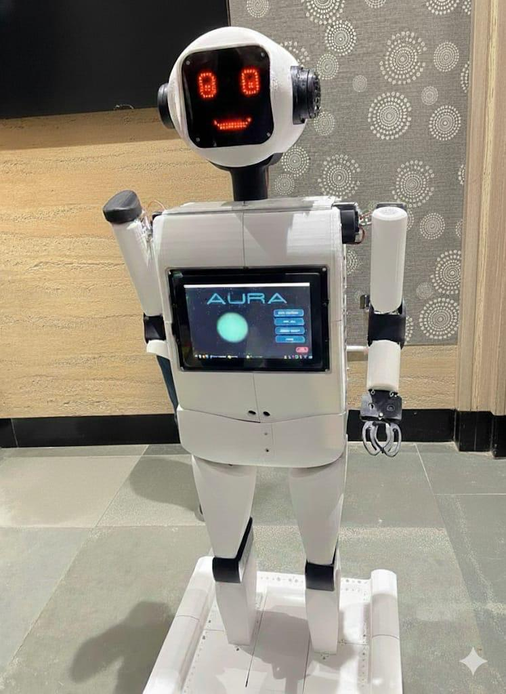
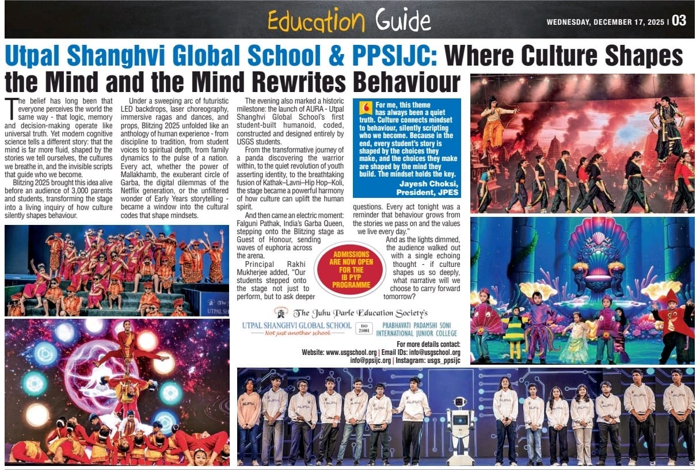

# 🤖 AURA: Automated Unified Robotic Assistant

My school's first student-built humanoid assistant. It registers faces, recognizes and greets people, and answers spoken questions about the school through a custom animated interface. It launched in front of 3,000 parents and students at Blitzing 2025 and was featured in the Times of India Education Guide on December 17, 2025.

  

### Developed by the Humanoid Team
**Head Coder and Team Lead: Mohit Sheth**

**Team Members**: Aarav Jain, Arnav Sharma, Tvisha, Prisha Kapadia, Pahal Shah

**My part:** I built the entire GUI and all of its features, led the team, taught my teammates Python, and delegated their work.

---

## 🧠 Overview

The **Humanoid Project** is a school-based research and development initiative focused on building an intelligent, interactive humanoid system. AURA was designed, coded and built by students.

**My story:** I was inspired by Jarvis from Iron Man when I designed the GUI, and that gave me the idea of a pulsing orb. It looked close to impossible to build, but I knew AURA wouldn't feel complete without a heartbeat. Now I can't imagine AURA without it.

---

## 🌟 Key Features

- Face registration from webcam samples
- Recognizes registered users and greets them out loud
- Answers spoken questions about the school: principal, school name, location, motto, year founded, and grades offered
- Animated interface with an orb that pulses like a heartbeat

---

## 🛠 Built With

Python, OpenCV (face detection), LBPH with a KNN fallback (face recognition), PyQt5 (interface), AssemblyAI (speech-to-text), pyttsx3 (spoken replies)

---

## ▶️ How to Run

1. Install Python 3 and the libraries: `pip install opencv-contrib-python numpy pyttsx3 PyQt5 sounddevice scipy assemblyai pygame`
2. Get your own AssemblyAI API key and set it as an environment variable named `ASSEMBLYAI_API_KEY` (for example, `setx ASSEMBLYAI_API_KEY "your-key"` in Windows PowerShell, then reopen the terminal).
3. Run `python HumanoidGui.py`. The GUI starts the other scripts for you:
   - `train.py` registers a new face from webcam samples
   - `recognise.py` recognizes and greets registered users
   - `queries_api.py` listens to a spoken question and answers it

---

## ⚠️ Known Limitations

- Answers come from a fixed list of school facts matched by keywords, so AURA can't answer other questions yet.
- Speech-to-text needs an internet connection and an AssemblyAI key.

---

## 📰 In the press

---

AURA in ACTION 🔥

